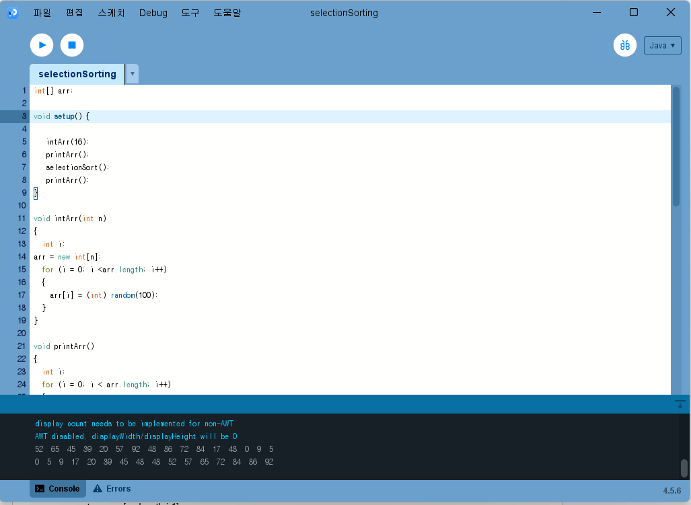
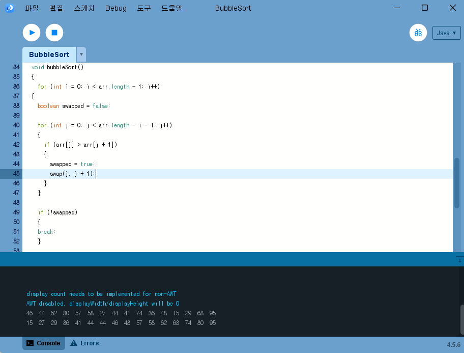
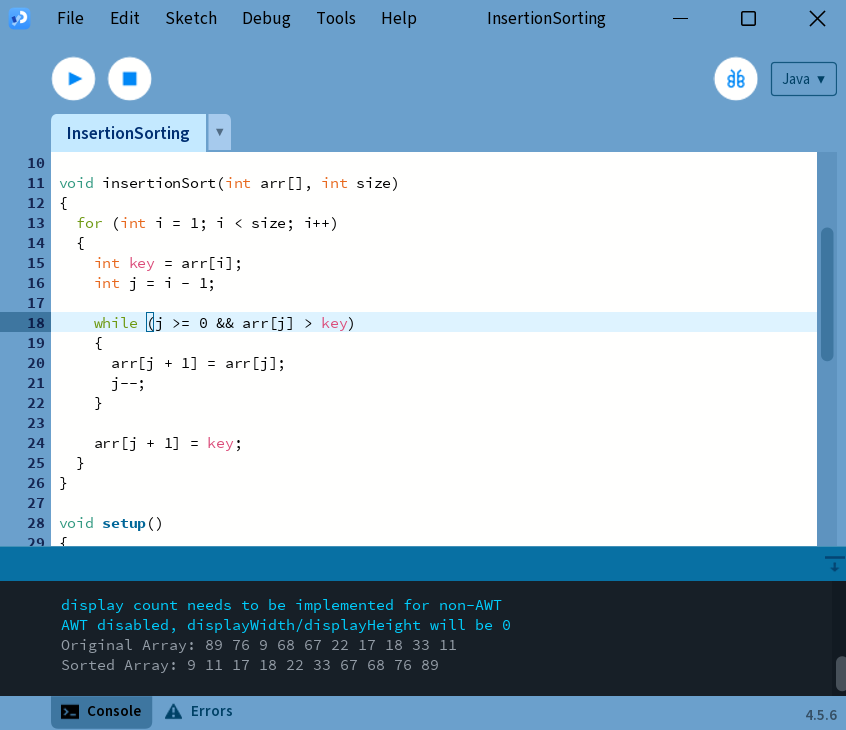
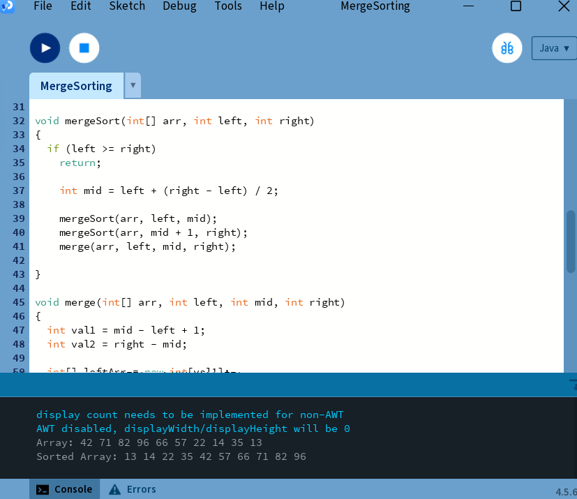
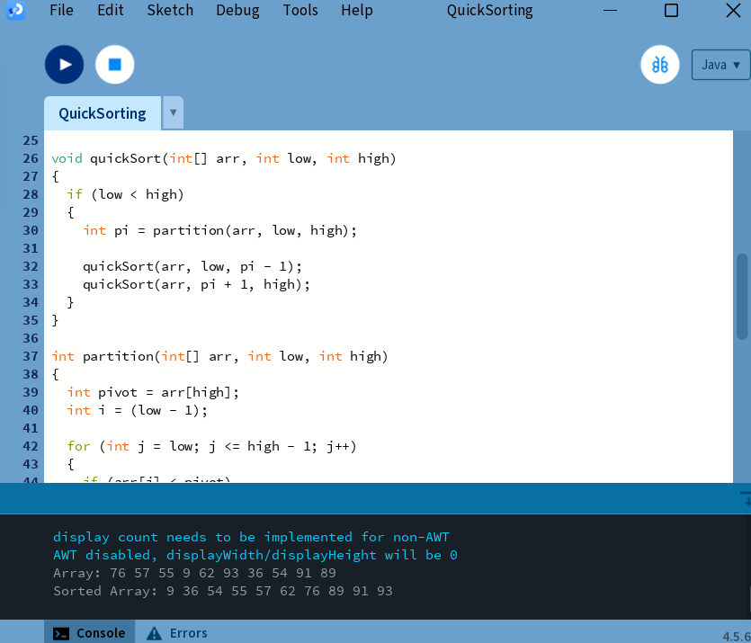
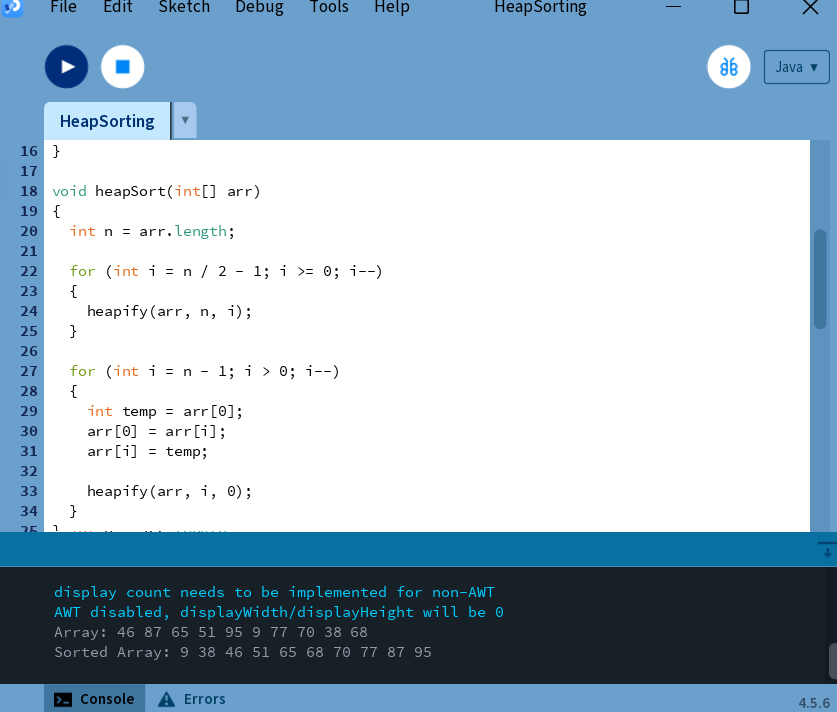
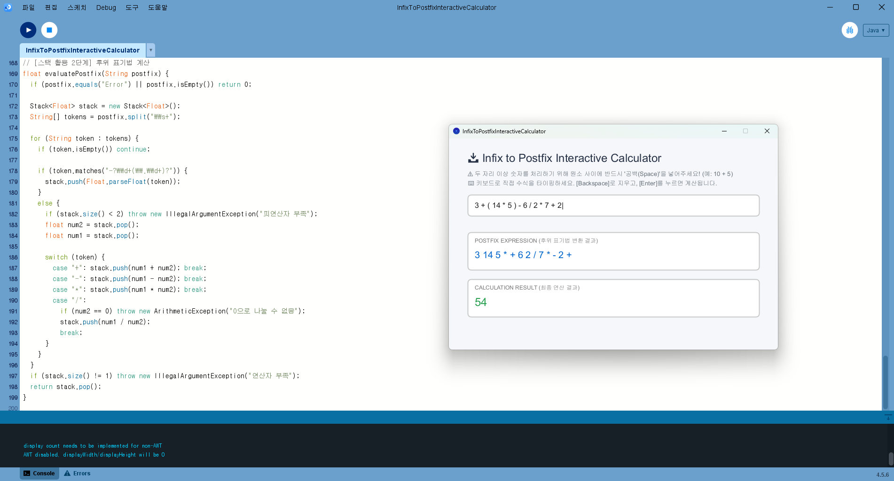

# Algorithm2026
### Homework1

[SelectionSorting](./homework/SelectionSorting.pde)

[BubbleSort](./homework/BubbleSort.pde)

[InsertionSort](./homework/InsertionSorting.pde)

[MergeSort](./homework/MergeSorting.pde)

[QuickSort](./homework/QuickSorting.pde)

[HeapSort](./homework/HeapSorting.pde)

[SortingAnimation](./homework/SortingAnimation.pde)

https://github.com/user-attachments/assets/efe7b48b-776f-461c-a9b3-ca015013b315

[BinarySearchTree](./homework/BinarySearchTree.pde)

https://github.com/user-attachments/assets/b98a2d51-fb7e-40ec-a248-f12fea127cdc

[InfixToPostfixInteractiveCalculator](./homework/InfixToPostfixInteractiveCalculator.pde)

